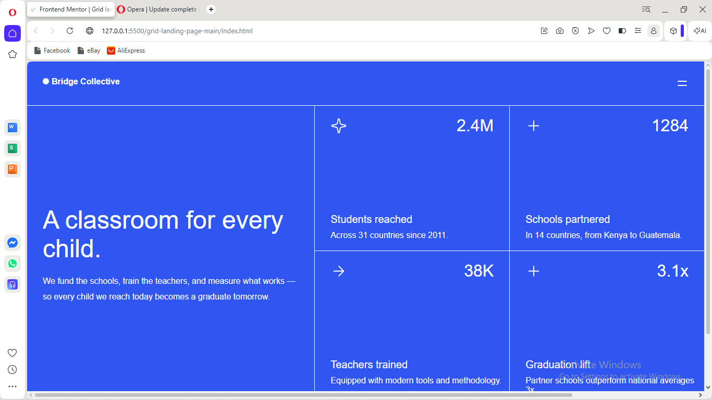

# Grid Landing Page

A solution to the Grid Landing Page challenge on [Frontend Mentor](https://www.frontendmentor.io).

## Table of Contents

- [Overview](#overview)
- [My Process](#my-process)
- [What I Learned](#what-i-learned)
- [Continued Development](#continued-development)
- [Author](#author)

## Overview

### The Challenge

Build the landing page so that it:

- Matches the provided design as closely as possible
- Uses CSS Grid to arrange the page sections
- Adapts to different screen sizes (mobile, tablet, desktop)
- Shows hover and focus states on interactive elements

### Screenshot

### Links

- Solution: [Frontend Mentor solution page](https://www.frontendmentor.io)
- Live site: https://frontendmentor-challenge-iota.vercel.app/

## My Process

### Built With

- Semantic HTML5
- CSS custom properties
- CSS Grid and Flexbox

## What I Learned

- How to define layouts with `grid-template-columns` and `grid-template-areas`
- Switching from a single-column mobile layout to a multi-column desktop layout with media queries

## Continued Development

- Improve accessibility (focus styles, alt text, heading order)
- Add smoother transitions on hover states

## Author

**Abegunde Emmanuel Abiodun (Hemarnuel)**
- GitHub: [@Hemarnuel10](https://github.com/Hemarnuel10)
- x: https://x.com/hemarnueldev
- Linkedin: https://www.linkedin.com/in/emmanuelabegunde